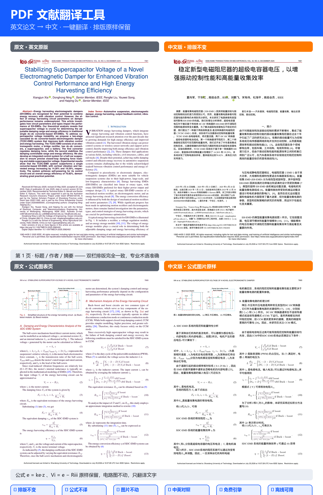

# PDF 文献翻译工具（pdf2zh-cn-gui）

**英文论文 → 中文，排版不变，公式与图片不翻译。**

基于开源项目 [PDFMathTranslate (pdf2zh)](https://github.com/Byaidu/PDFMathTranslate)（GPL-3.0）的中文增强版：
中文图形界面、实时翻译进度、稳定性修复补丁，以及一键离线便携包构建脚本。



## ✨ 特性

- 🖥️ **中文图形界面**：拖入 PDF → 点「开始翻译」→ 下载「中文版」+「中英对照版」两份 PDF
- 📊 **实时进度**：显示版面解析页数、段落翻译计数、失败段落数；翻译服务不可用时立即提示，不会假死卡住
- 🧮 **公式不翻译、图片不动**：数学公式原样保留，图/表区域不动，只翻译文字与图注
- 🔑 **多引擎**：Google（免费，默认）/ DeepSeek（OpenAI 兼容，质量最佳）/ DeepL / DeepLX / Ollama / Azure
- 💾 **段落翻译缓存**：同一篇文档重复翻译秒级完成
- 📦 **离线便携包**：一键构建"免安装"离线安装包，新电脑双击即用（内嵌 Python，无需联网）

## 🛠️ 相对上游 PDFMathTranslate 的修复（4 个）

| # | 问题 | 修复 |
|---|---|---|
| 1 | NumPy 2.x 下 `np.fromstring` 已移除，翻译直接崩溃 | 改用 `np.frombuffer` |
| 2 | 首字下沉（如 Introduction 的大写首字母）被误判为公式，**整段漏译** | 段落基准字号以第二个字符重建 |
| 3 | 翻译服务限流时无限重试，界面卡死；空译文还会被缓存 | 有限重试 + 失败保留原文 + 空译文不缓存 |
| 4 | 请求无超时，网络异常时长时间挂起 | 请求加 15 秒超时 |

## 🖥️ 安装教程

### 方式一：离线便携包（推荐 Windows 新手，无需安装 Python、全程离线）

1. 下载现成的 `PDF-Translator-Portable.zip`（见 [GitHub Releases](../../releases) 或作者分享链接；也可按下方说明自行构建）
2. 解压到任意目录，例如 `D:\PDF翻译工具`
3. 双击 **`安装.bat`**，等待 5~10 分钟（自动装好内置 Python 3.13、全部依赖、版面模型与修复补丁）
4. 双击桌面的 **「PDF文献翻译工具」** 快捷方式 → 浏览器自动打开 http://127.0.0.1:7860
5. 拖入英文 PDF → 点「开始翻译」→ 下载「中文版」与「中英对照版」

> 要求：Windows 10/11 64 位；安装后请勿移动/删除工具目录；结果保存在目录内 `翻译输出` 文件夹。

### 方式二：源码安装（Windows / macOS / Linux，需 Python 3.10+）

```bash
# 1. 安装上游（本修复针对 1.7.9）
pip install pdf2zh==1.7.9

# 2. 应用本仓库的修复补丁（幂等，可重复运行）
python apply_patches.py

# 3. 启动中文界面
python app/pdf2zh_gui_cn.py
```

浏览器自动打开 **http://127.0.0.1:7860**，拖入英文 PDF 即可翻译。

> 首次运行会自动下载版面分析模型（约 80 MB，来自 Hugging Face）。
> 国内网络可先设置镜像：`set HF_ENDPOINT=https://hf-mirror.com`（Windows）/ `export HF_ENDPOINT=https://hf-mirror.com`（macOS/Linux）。

## 💎 强烈推荐：接入 DeepSeek API（效果最好、价格极低）

免费网页引擎虽然零成本，但翻译质量、术语准确度和稳定性都不如大模型 API。
**DeepSeek 的中英学术翻译质量与 GPT 同档，价格却便宜一个数量级**——百万 token 仅几毛到一两块钱，
翻译一篇 10 页论文的成本不到 1 分钱，充值几块钱能用几个月。

- 🔗 注册与充值：[platform.deepseek.com](https://platform.deepseek.com)（注册后在控制台少量充值即可）
- 🔗 获取 API Key：[platform.deepseek.com/api_keys](https://platform.deepseek.com/api_keys)（点「创建 API Key」，复制 `sk-` 开头的密钥）
- 🔗 官方定价：[api-docs.deepseek.com/quick_start/pricing](https://api-docs.deepseek.com/quick_start/pricing/)

### 在翻译软件里选择 DeepSeek（3 步）

1. 打开界面 http://127.0.0.1:7860
2. 「② 翻译引擎」下拉框选择 **「OpenAI 兼容 / DeepSeek（需密钥，质量最佳）」**
3. 展开「🔑 模型与密钥设置」，只需填 **「OpenAI 兼容密钥」**（粘贴 `sk-...`），其余保持默认：
   - 接口地址：`https://api.deepseek.com`（默认，勿改）
   - 模型名称：`deepseek-chat`（默认，勿改）

点「开始翻译」后，界面会先自动连通测试一次：密钥无效会提示 401、模型名错误会提示 404，一眼定位问题。

## 📦 构建离线便携包（可选）

在 Windows 上运行 `offline_package\build_package.bat`，会在 `dist\PDF翻译工具便携包` 生成
免安装离线安装包（含 Python 3.13、全部依赖、版面模型、修复补丁），并压缩为 ZIP。
拷贝到任意 Windows 10/11 64 位电脑，双击 `安装.bat` 即完成安装（全程离线）。

## 🔑 翻译引擎与密钥

| 引擎 | 费用 | 说明 |
|---|---|---|
| Google | 免费 | 默认；连续大量翻译可能临时限流，等几分钟重试即可 |
| OpenAI 兼容 / DeepSeek | 需密钥 | **推荐！** 质量最佳且极便宜，见上方「💎 DeepSeek」章节 |
| DeepL | 免费密钥 | 在 deepl.com 注册免费 API 后填入 |
| DeepLX | 免费 | 需自建服务 |
| Ollama | 免费 | 本机运行 Ollama，填入模型名（如 `gemma2`） |
| Azure | 需密钥 | 需 AZURE_APIKEY / AZURE_ENDPOINT / AZURE_REGION |

## ❓ 常见问题

- **提示"有 N 段因限流保留原文"**：翻译服务临时限流，稍后重新翻译该文件即可补全（已翻译段落走缓存）。
- **端口被占用**：设置环境变量 `PDF2ZH_PORT=7861` 后重启界面。
- **翻译完找不到文件**：结果同时保存在脚本旁的 `翻译输出` 文件夹。

## 📜 许可证

本项目以 **GPL-3.0** 开源（与上游 PDFMathTranslate 一致）。`patches/` 目录内的文件为
上游代码的修改版，版权归原项目作者所有，按 GPL-3.0 分发。

- 上游项目：https://github.com/Byaidu/PDFMathTranslate

## ⚠️ 免责声明

本工具仅用于辅助阅读学术文献，请遵守所在机构对文献使用与翻译的版权规定。
